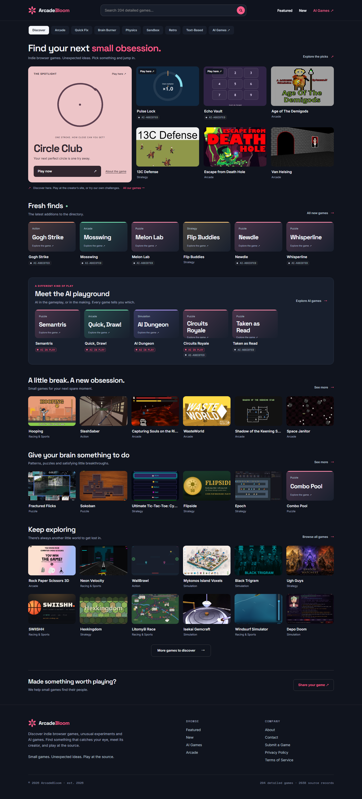

# <p align="center"></p>

<h1 align="center">ArcadeWorld</h1>

<p align="center"><strong>Discover games. Explore new worlds. Play beyond the ordinary.</strong></p>

<p align="center">
  <a href="https://arcadeworld.pages.dev" target="_blank" rel="noopener noreferrer">🌐 Live site</a>
  ·
  <a href="https://github.com/ayushcmd/ArcadeWorld" target="_blank" rel="noopener noreferrer">📁 Repository</a>
</p>

---

## 📸 Website preview

<div align="center">
  
</div>

---

## 🎮 About ArcadeWorld

ArcadeWorld is a curated, **outbound‑link** directory of indie browser games, game‑jam entries, experimental demos, and AI‑enhanced titles. Each listing presents a concise description, proper attribution, and a direct link to the game’s official host. The platform never hosts or modifies third‑party games; it merely connects players with the creators.

---

## ✨ Key Features

- **Rich catalogue** – Over 2,000 games organized into six top‑level categories (Puzzle, Action, Arcade, Strategy, Racing & Sports, Simulation).
- **AI labeling** – Games that use AI in gameplay or were built with AI assistance are clearly marked with disclosures.
- **Hosted challenges** – Stand‑alone browser challenges (Circle Club, Pulse Lock, Echo Vault, Anarch) are built in‑house and playable directly.
- **Responsive design** – Fully usable on mobile, tablet, and desktop with accessible focus rings and semantic markup.
- **Privacy‑first** – No required accounts, no tracking scripts, and only local storage for hosted‑challenge scores.
- **Static site** – Generated with Eleventy, served as a performant, SEO‑friendly static site on Cloudflare Pages.

---

## 🔍 Explore the Platform

- **Home** – <https://arcadeworld.pages.dev/>
- **Featured games** – <https://arcadeworld.pages.dev/featured/>
- **New arrivals** – <https://arcadeworld.pages.dev/new/>
- **Category view** – Example: <https://arcadeworld.pages.dev/category/puzzle/>
- **Game detail** – Example: <https://arcadeworld.pages.dev/game/hextris/>
- **Hosted challenges** – <https://arcadeworld.pages.dev/play/circle-club/>, <https://arcadeworld.pages.dev/play/pulse-lock/>, <https://arcadeworld.pages.dev/play/echo-vault/>
- **RSS feed** – <https://arcadeworld.pages.dev/rss.xml>

---

## 🛠️ Technology Stack

| Technology | Role |
|------------|------|
| **Eleventy (11ty)** | Static‑site generator, Nunjucks templating |
| **Tailwind CSS** | Utility‑first styling with custom brand tokens |
| **Node.js** (v20+) | Build scripts, development server |
| **Playwright** | End‑to‑end smoke and challenge‑game testing |
| **Cloudflare Pages** | Host static output (`dist/`) |

---

## 📁 Project Architecture

```text
ArcadeWorld/
├─ src/                     # Eleventy source files
│  ├─ _data/               # Game catalogue, tags, site config
│  ├─ _includes/           # Nunjucks layout fragments (base, brand‑mark, cards)
│  ├─ static/              # Public assets (logos, favicon, hosted games)
│  ├─ styles/              # Tailwind + custom design tokens (styles.css)
│  └─ *.njk                # Page templates (index, game, category…)
├─ games/                   # Source for hosted challenge games
├─ scripts/                 # Data pipeline, validation, screenshot utilities
├─ tests/                   # Playwright test suites
├─ docs/                    # Architecture decisions, ADRs
├─ .eleventy.js            # Eleventy configuration & filters
├─ tailwind.config.js       # Tailwind configuration with brand colors
├─ package.json             # npm scripts, dependencies
└─ README.md                # <‑‑ you are reading this file!
```

---

## 🚀 Getting Started

### Prerequisites

- **Node.js** ≥ 20
- **npm** (comes with Node)

### Installation

```bash
# Clone the repository
git clone https://github.com/ayushcmd/ArcadeWorld.git
cd ArcadeWorld

# Install exact dependencies
npm ci

# Install Playwright browsers (required for tests)
 npx playwright install chromium
```

### Development

```bash
npm run serve   # Starts Tailwind watch + Eleventy dev server (http://localhost:8080)
```

### Build & Deploy

```bash
npm run build   # Lint, validate, compile Tailwind, generate static site → dist/
```

The resulting `dist/` folder is ready for deployment to Cloudflare Pages (set the build command to `npm run build` and the output directory to `dist`).

### Validation & Testing

```bash
npm run validate               # Schema audit (warnings only)
npm run validate:strict        # Strict validation (errors on data issues)
npm test                       # Playwright smoke & challenge‑game suite
```

---

## 📚 Game Catalogue & Data Pipeline

- The master catalogue resides in `src/_data/games.js`.
- Each entry follows the strict schema defined in the file (id, slug, name, category, tagline, about, howToPlay, keyFeatures, screenshots, sourceName, sourceUrl, licence, tags, addedDate, releaseDate, featured, plus optional `ai.*` fields for AI games).
- Adding a new game requires a unique `sourceKey`, monotonic `id`, and tags from `src/_data/tags.js`. Run `npm run validate:strict` to ensure compliance, then rebuild with `npm run build`.

---

## 📦 Deployment

ArcadeWorld is hosted on **Cloudflare Pages**. The CI workflow (`.github/workflows/ci.yml`) performs:

1. `npm ci`
2. `npm run validate:strict`
3. `npm run build`
4. Deploys the `dist/` directory.

The live site is available at **https://arcadeworld.pages.dev**.

---

## 🤝 Contributing

We welcome contributions!

- **Issues:** Open a GitHub issue for bugs, feature ideas, or documentation fixes.
- **Pull Requests:** Fork the repo, create a feature branch, and submit a PR.
- Follow the existing code style (four‑space indent, kebab‑case filenames, Tailwind utility ordering).
- Run `npm run validate:strict` and `npm test` before submitting.

See `CONTRIBUTING.md` for detailed guidelines.

---

## 📄 License & Attribution

- **Code:** MIT License – see [LICENSE](LICENSE).
- **Brand assets & documentation:** © 2026 ArcadeWorld. All rights reserved.
- **Game catalogue data:** Individual games retain their original licences and attributions. See [CONTENT‑LICENSE.md](CONTENT‑LICENSE.md) for details.

---

<div align="center">
  <a href="https://arcadeworld.pages.dev" target="_blank" rel="noopener noreferrer">
    
  </a>
  <p>© 2026 ArcadeWorld – Powered by open‑source community.</p>
</div>
